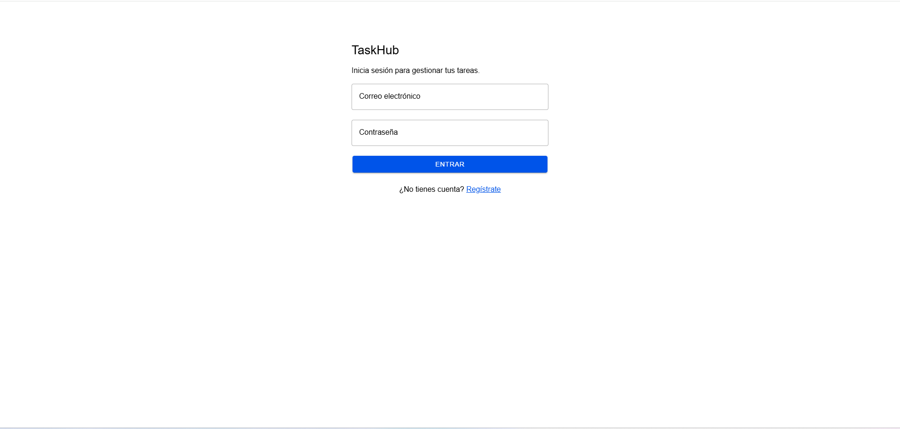
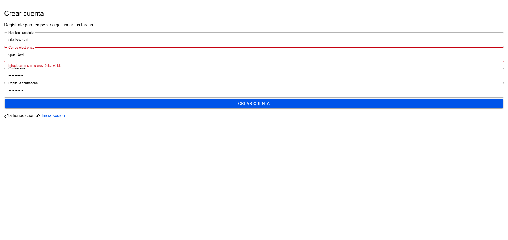
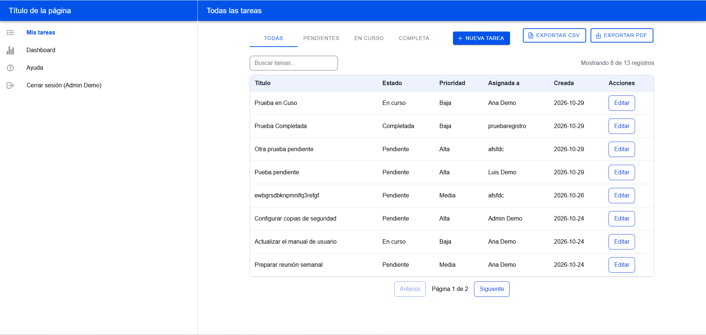
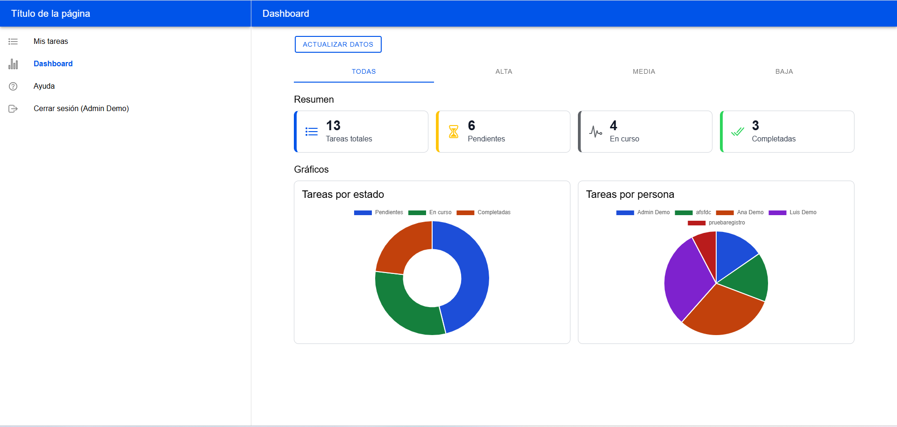

# Manual de usuario de TaskHub

## 1. Qué es TaskHub
Aplicación para gestionar tareas de equipo. Hay dos perfiles:
- **Usuario estándar:** gestiona sus propias tareas.
- **Administrador:** gestiona todas las tareas y ve el dashboard.

## 2. Acceso a la aplicación
### 2.1 Iniciar sesión
1. Abre la dirección de la aplicación.
2. Escribe tu correo y tu contraseña.
3. Pulsa **Entrar**.

### 2.2 Crear una cuenta
1. En el login, pulsa **Regístrate**.
2. Rellena nombre, correo y contraseña (mínimo 6 caracteres).
3. Si el correo ya existe, aparecerá un aviso.

### 2.3 Cerrar sesión
En el menú lateral, pulsa **Cerrar sesión**.

## 3. Gestión de tareas
### 3.1 Ver y buscar tareas
Usa los botones superiores para filtrar por estado y el cuadro de búsqueda para buscar texto.

### 3.2 Crear una tarea
1. Pulsa **Nueva tarea**.
2. Escribe el título (obligatorio) y elige estado y prioridad.
3. Pulsa **Guardar**.

### 3.3 Editar o eliminar
Pulsa **Editar** en la fila. Solo el administrador puede eliminar o asignar tareas a otras personas.

## 4. Exportar informes
Pulsa **Exportar CSV** o **Exportar PDF**. El informe contiene las tareas que ves con el filtro actual.

## 5. Dashboard (solo administrador)
Muestra totales, gráficos por estado y por persona, y un filtro por prioridad.

## 6. Accesibilidad
La aplicación se puede usar solo con teclado (Tab, Intro, Espacio, Escape) y es compatible con lectores de pantalla.

## 7. Problemas frecuentes
| Problema | Solución |
|---|---|
| No puedo iniciar sesión | Revisa el correo y la contraseña |
| No veo el Dashboard | Solo está disponible para administradores |